<p align="center">
  <a href="https://tensorforge.dev">
    
  </a>
</p>

<p align="center">
  <a href="https://github.com/FAAS19/tensorforge-blueprints/actions/workflows/ci.yml"></a>
  <a href="https://n8n.io/"></a>
  <a href="LICENSE"></a>
</p>

> **3 self-contained, importable n8n workflow blueprints for Australian healthcare clinics, accounting teams, and operations leaders, plus a 1-command Docker Compose runner.**
>
> Engineered by **[TensorForge (`tensorforge.dev`)](https://tensorforge.dev)** · Melbourne, Australia

---

## 1. Why This Workflow Pack Exists

Most AI automation demos break in production because they wire raw LLM JSON straight into **Cliniko**, **Halaxy**, **Xero**, or **HubSpot**. A single hallucinated digit in an Australian Medicare card number, Medicare Provider number, or ATO ABN corrupts downstream records or triggers silent API rejections.

Every workflow in this pack runs **100% inside standard self-hosted n8n** (zero external Python servers to host) with an embedded JavaScript **Checksum & Quarantine Gate** that verifies Australian identifiers before any API write occurs:

<p align="center">
  
</p>

---

## 2. Included n8n Workflows (`workflows/`)

Import any JSON file directly into your n8n canvas (**Workflows → Import from File**):

| # | Workflow File | Trigger → AI → Deterministic Gate → Commit / Quarantine |
| :--- | :--- | :--- |
| **01** | [`workflows/01_clinical_referral_to_cliniko.json`](workflows/01_clinical_referral_to_cliniko.json) | **Clinical Referral PDF → Cliniko EHR + Slack DLQ**<br>Extracts patient referral PDFs with Claude, verifies **11-digit Services Australia Medicare Card + IRN checksums** (`[1,3,7,9,1,3,7,9] mod 10`), **Medicare Provider Number PLV mod-11 check characters**, and real calendar dates (`YYYY-MM-DD`), then creates the patient in **Cliniko** (`api.au1.cliniko.com/v1/patients`) or alerts **Slack** on failure. |
| **02** | [`workflows/02_supplier_invoice_to_xero.json`](workflows/02_supplier_invoice_to_xero.json) | **Supplier Tax Invoice PDF → Xero Draft Bill + Finance DLQ**<br>Extracts Australian tax invoices, verifies **11-digit ATO ABN modulo-89 maths** (`sum % 89 === 0`) and exact **10% GST line arithmetic** (`subtotal_cents + gst_cents === total_cents`), then posts an `ACCPAY` `DRAFT` bill to **Xero** (`/api.xro/2.0/Invoices`) or quarantines to **Slack**. |
| **03** | [`workflows/03_inbound_lead_triage_to_slack.json`](workflows/03_inbound_lead_triage_to_slack.json) | **Inbound Service Enquiry → HubSpot CRM + Slack Draft Reply**<br>Classifies inbound web/email enquiries, normalises **Australian mobile & landline numbers to `+61` E.164**, filters cold solicitation spam, creates qualified contacts in **HubSpot CRM** (`/crm/v3/objects/contacts`), and dispatches a ready-to-send reply in **Slack** (or alerts the **Slack DLQ** on validation failure). |

---

## 3. 60-Second Quickstart (Self-Hosted n8n via Docker)

Spin up a local, Melbourne-timezoned (`Australia/Melbourne`) self-hosted n8n instance with the `workflows/` directory mounted:

```bash
# 1. Clone the repository
git clone https://github.com/FAAS19/tensorforge-blueprints.git
cd tensorforge-blueprints

# 2. Copy environment defaults and start n8n on http://localhost:5678
cp .env.example .env
docker compose up -d
```

Then open `http://localhost:5678`, click **Import from File**, and select any workflow from [`workflows/`](workflows/).

---

## 4. Verify the Checksum Gates Offline (Zero Dependencies)

You can test the embedded JavaScript validation nodes from all 3 workflows against valid and hallucinated Australian clinical/financial fixtures in [`examples/sample_webhook_payloads.json`](examples/sample_webhook_payloads.json) using standard Node.js:

```bash
node --test tests/verify_workflows.mjs
```

<p align="center">
  
</p>

---

## 5. Need This Customised for Your Practice or Operations Stack?

**[TensorForge (`tensorforge.dev`)](https://tensorforge.dev)** is an independent Applied AI & Business Task Automation practice based in Melbourne, Australia. Work directly with a Solo Principal Engineer (zero agency bloat, 100% client IP handover) to deploy production document intake pipelines, custom self-hosted n8n infrastructure, and FastMCP servers.

- **Website & Interactive Pipeline Sandbox**: [https://tensorforge.dev](https://tensorforge.dev)
- **Machine-Readable Agent Spec (`llms.txt`)**: [https://tensorforge.dev/llms.txt](https://tensorforge.dev/llms.txt)
- **Direct Engineering Dispatch**: [`contact@tensorforge.dev`](mailto:contact@tensorforge.dev?subject=Automation%20Enquiry%20-%20TensorForge)
